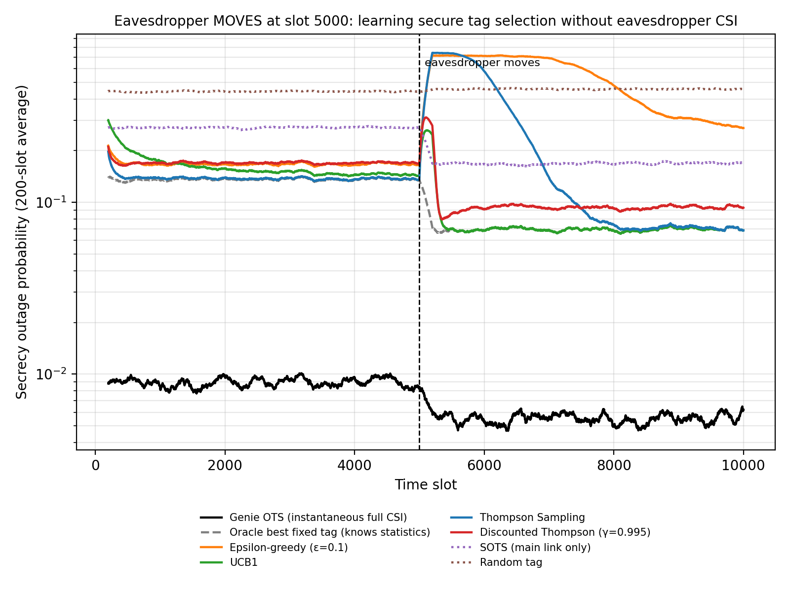
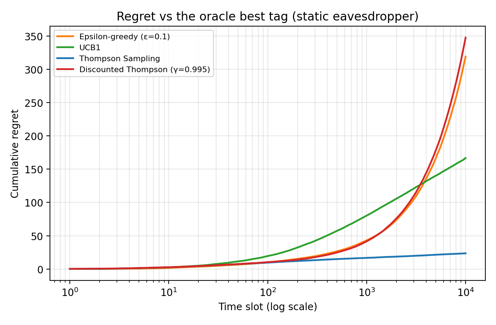
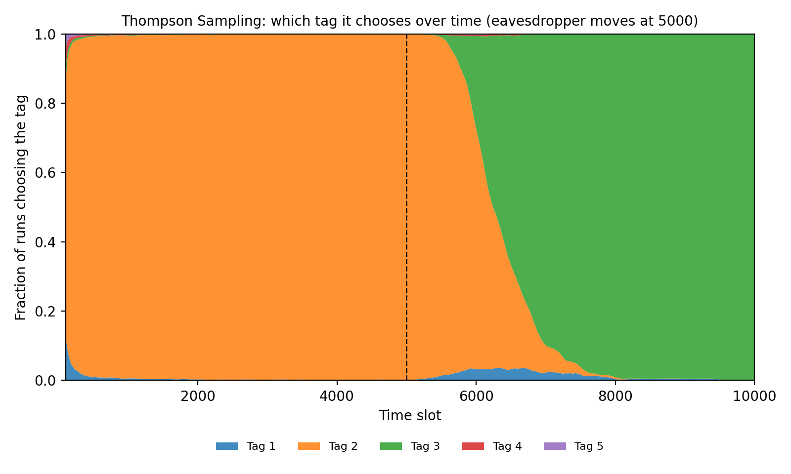

# Learning Secure Tag Selection Without Eavesdropper CSI (Multi-Armed Bandits)

[](https://colab.research.google.com/github/nafees-iiit/rl-secure-tag-selection-bandits/blob/main/bandit_secure_tag_selection.ipynb)

Reinforcement-learning (multi-armed bandit) tag selection for secure ambient-backscatter IoT that
needs **no eavesdropper channel knowledge** — only a 1-bit "secure / not secure" feedback — and
**adapts when the eavesdropper moves**.

**Author:** Mohammad Nafees, Ph.D. Scholar (ECE), MNNIT Allahabad
**Related work:** [arXiv:2503.12400](https://arxiv.org/abs/2503.12400) · [ML tag selection with noisy CSI](https://github.com/nafees-iiit/ml-tag-selection-backscatter)

---

## 1. Problem

Five backscatter tags sit at different places; a passive eavesdropper hides near some of them.
Optimal tag selection (OTS) needs the eavesdropper's instantaneous channel — impossible for a
passive eavesdropper. What can a controller learn using only whether each transmission was secure?

- Secrecy capacity of tag *k*: `C_s,k = [log2(1+SNR·β·|h_k|²|g_k|²) − log2(1+SNR·β·|h_k|²|f_k|²)]⁺`
- Feedback after each slot: `r = 1` if `C_s ≥ R_s`, else `0` (e.g. from a periodic security audit).

## 2. Method — the tag-selection problem as a multi-armed bandit

| Learner | Idea |
|---|---|
| ε-greedy (ε = 0.1) | Use the best tag so far, explore a random tag 10 % of the time |
| UCB1 | Add an optimism bonus to rarely tried tags |
| Thompson Sampling | Keep a Beta belief per tag, sample, pick the best sample |
| Discounted Thompson (γ = 0.995) | Thompson Sampling that slowly forgets old evidence → adapts to change |

Baselines: genie OTS (instantaneous full CSI), oracle best fixed tag (knows long-run statistics),
SOTS (main link only), random. Nakagami-*m* = 2, SNR 15 dB, β = 0.5, R_s = 0.5, 10,000 slots,
200 independent runs, identical channels for all schemes in every slot.

## 3. Results

| Scheme | SOP, static eavesdropper | SOP, first 1000 slots after the eavesdropper moves | SOP, last 2000 slots |
|---|---:|---:|---:|
| Genie OTS (instantaneous full CSI) | 0.009 | 0.006 | 0.006 |
| Oracle best fixed tag (knows statistics) | 0.137 | 0.069 | 0.070 |
| Epsilon-greedy (ε=0.1) | 0.168 | 0.715 | 0.322 |
| UCB1 | 0.141 | 0.105 | 0.070 |
| Thompson Sampling | 0.137 | 0.694 | 0.071 |
| Discounted Thompson (γ=0.995) | 0.171 | 0.127 | 0.093 |
| SOTS (main link only) | 0.271 | 0.168 | 0.169 |
| Random tag | 0.444 | 0.457 | 0.457 |



**Key findings**

- Without any eavesdropper CSI, **Thompson Sampling matches the oracle best tag** (SOP 0.137) with only
  **≈ 24 lost secure transmissions in 10,000 slots** — far below ε-greedy (319) and UCB1 (167).
- It also halves the outage of SOTS, which ignores the eavesdropper (0.137 vs 0.271).
- **When the eavesdropper moves**, plain Thompson Sampling keeps trusting its old favourite tag
  (SOP ≈ 0.69 for the next 1000 slots); **Discounted Thompson recovers almost immediately (≈ 0.13)**.
- Trade-off: forgetting costs a little in a static world (0.171 vs 0.137). UCB1 sits in between.
- Genie OTS (0.009) shows the value of instantaneous CSI that a passive eavesdropper never gives.




## 4. How to run

```bash
git clone https://github.com/nafees-iiit/rl-secure-tag-selection-bandits.git
cd rl-secure-tag-selection-bandits
pip install -r requirements.txt
python bandit_secure_tag_selection.py
```

Or click **Open in Colab** above → **Runtime → Run all** (≈ 30 seconds).

## 5. Limitations and next steps

- Assumes a 1-bit secure/not-secure feedback is available (e.g. audits, honeypot nodes).
- Tags' average channels are fixed apart from the one eavesdropper move; no tag mobility.
- Next: contextual bandits that also use the instantaneous main-link CSI, and deep RL with
  energy-harvesting state.

## License

MIT
